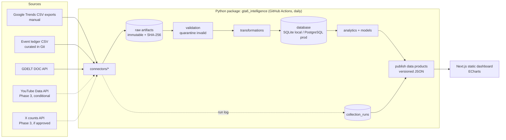

# System Architecture (Proposed)

**Status:** Proposed in Phase 0 — see [Decision 0001](../decisions/0001-initial-architecture.md)
**Principle:** build the simplest system that gives a traceable path from source to chart, then add complexity only when measured needs require it (PRD §10).

## Overview



## Components

### 1. Python package — `src/gta6_intelligence/`

Layout follows PRD §11:

```text
src/gta6_intelligence/
├── config/          # pydantic-settings; reads env vars, never hard-coded secrets
├── connectors/      # one module per source; all implement BaseConnector
├── collection/      # run lifecycle, locking, retries, per-source isolation
├── validation/      # pydantic schemas, range checks, quarantine
├── transformations/ # raw → staging → curated
├── analytics/       # descriptive stats, event windows, change points
├── features/        # leakage-safe feature building (as-of timestamps)
├── models/          # baselines, forecasters, model run registry
├── reporting/       # daily/weekly reports, data-product publishing
├── utils/           # logging (JSON, secret redaction), time, hashing
└── cli.py           # `gta6 collect --source gdelt`, `gta6 collect --all`, `gta6 publish`
```

**Connector contract** (every source implements the same steps):

1. `fetch(run) -> RawArtifact`: gets data and returns the bytes unchanged, plus request parameters.
2. The runner writes the artifact to `data/raw/<source>/<YYYY>/<MM>/<DD>/<run_id>.<ext>`, computes the SHA-256 and records it in `raw_artifacts`.
3. `parse(artifact) -> list[Record]`: turns raw data into typed records, validated with Pydantic.
4. Invalid records go to quarantine with a reason. They are never silently dropped.
5. Upserts use natural keys (for example source + query + geo + date + artifact), so a rerun never duplicates rows (idempotency).

**Failure isolation:** the runner catches errors per connector, marks that run `failed` or `partial`, and moves on to the next source. One failing source never stops the others (PRD §15).

### 2. Storage

| Layer | Local development | Production |
|---|---|---|
| Raw artifacts | `data/raw/` (gitignored) | Private storage — see [Decision 0004](../decisions/0004-production-storage-and-hosting.md) |
| Structured data | SQLite file (`data/gta6.db`) | PostgreSQL (free managed tier) |
| Schema changes | Alembic migrations | Same migrations |
| Analytical extracts | Parquet in `data/processed/` | Same, in private storage |
| Reference data (events) | `data/reference/*.csv` — **committed** | Same |

SQLAlchemy keeps the code the same across SQLite and PostgreSQL. The migration path is a `DATABASE_URL` change, which meets PRD §10 ("SQLite… if migration is planned").

**Why raw data is not committed to this public repository:** YouTube policy forbids redistributing API data and keeping it beyond 30 days. GDELT article lists contain third-party titles. The Charter (§6.5) bans large raw datasets in Git. Only our own curated reference data and clearly labelled test fixtures are committed.

### 3. Scheduling — GitHub Actions

- `ci.yml`: lint + tests on every pull request.
- `daily-collect.yml`: cron once per day plus manual `workflow_dispatch`. It uses `concurrency: daily-collect` so two runs never overlap (PRD F1). Secrets come from GitHub Actions Secrets.
- Standard GitHub-hosted runners are free for public repositories.
- Known limits: cron start times can drift under load, and **scheduled workflows in public repos are disabled after 60 days without repository activity**. Regular weekly-update commits prevent this. The Data Quality page shows "last successful run", so a silent stop would be visible.

### 4. Web app — static-first Next.js

- Next.js + TypeScript, built with `output: 'export'` into plain HTML/JS. Charts use ECharts. ECharts is preferred over Plotly for bundle size and fine-grained annotation of event markers.
- After each successful run, the pipeline publishes **data products**: small, versioned JSON files such as `search_interest.json`, `events.json`, `news_volume.json`, `status.json` and `models.json`. Each one carries its metadata: source, unit, geography, coverage period, retrieval time, processing version, and kind (observed / derived / predicted).
- The site reads only those files. The UI therefore cannot invent numbers, and every chart has its provenance attached (PRD F9 design rules).
- Hosting: GitHub Pages or Vercel (Decision 0004).

**Deviation from the PRD:** the PRD prefers FastAPI "where a separate backend API is useful". In the MVP it is not useful yet: all data is produced once per day. `status.json` stands in for a health endpoint. `backend/` stays as a reserved folder. A FastAPI service is added only if a concrete need appears, such as interactive filtering on large data. This needs approval in Decision 0001.

### 5. Observability

- A `collection_runs` row for every run: start/end (UTC), status, fetched/valid/rejected counts, errors.
- Structured JSON logs; secrets redacted by a logging filter.
- `status.json` published per run → Data Quality & Sources page (freshness, coverage, failures).
- A failed scheduled run makes the GitHub Actions job fail, and GitHub notifies the repository watchers.

### 6. Timestamps

All timestamps are stored in UTC. The following are kept apart (PRD §7): `published_at` (event), `coverage_date` (what the observation describes), `retrieved_at`, `processed_at`, and `published_data_at` (dashboard refresh). Backfilled data carries `collection_mode = 'backfill'`, separate from `'live'`.

## Technology choices

| Concern | Choice | Reason |
|---|---|---|
| Python | 3.13, pinned with uv | Full wheel coverage on macOS arm64; same version on both Macs and CI |
| Packaging | uv + `pyproject.toml` + `uv.lock` | Fast, reproducible, already installed for the Technical Lead |
| Validation / config | Pydantic v2, pydantic-settings | PRD preference |
| DB access | SQLAlchemy 2 + Alembic | SQLite → PostgreSQL without code changes |
| Data | pandas 3, NumPy, pyarrow | PRD preference |
| Stats / ML | statsmodels, scikit-learn; ruptures for change points | Baselines first; heavy libraries only when an experiment needs them |
| Lint / test | ruff, pytest | Standard, fast |
| Frontend | Next.js + TypeScript + ECharts, Node 26 LTS | PRD preference; static export |
